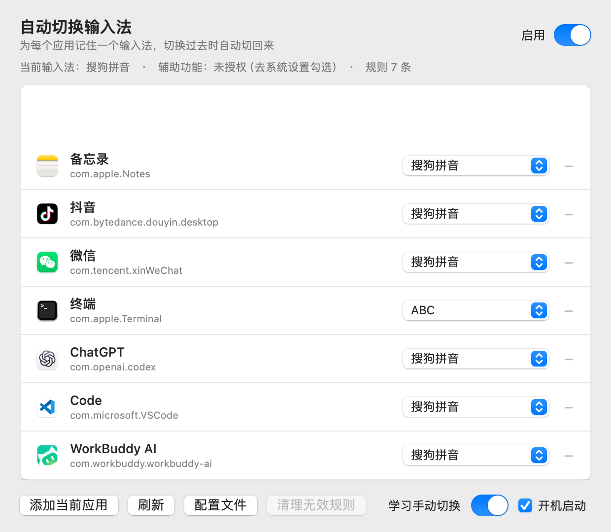
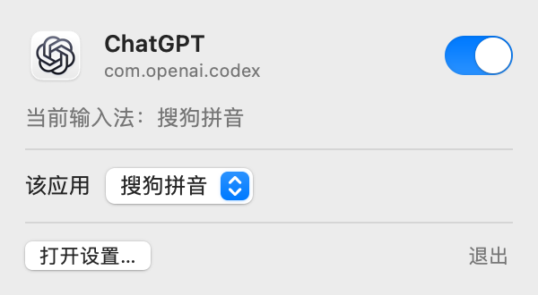
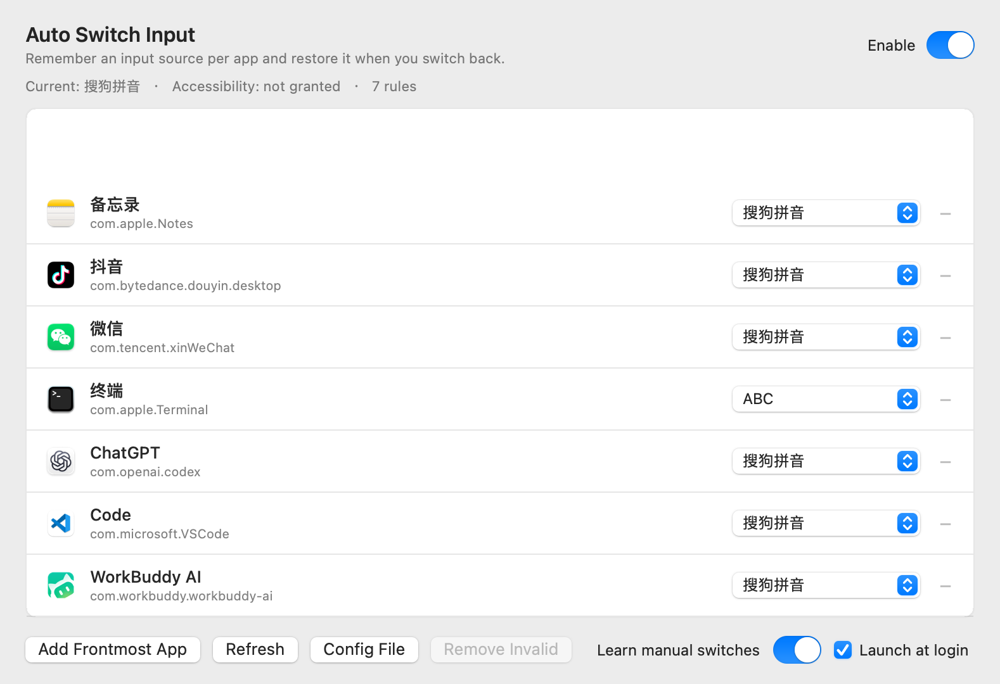

# Auto Switch Input · 自动切换输入法

[](https://github.com/zhoudaxiaa/AutoSwitchInput/actions/workflows/build.yml)
[](https://github.com/zhoudaxiaa/AutoSwitchInput/releases)
[](https://github.com/zhoudaxiaa/AutoSwitchInput)
[](LICENSE)

一个轻量的 macOS 菜单栏小工具：**为每个应用记住一个输入法，切过去时自动切回来。**

写它的原因很简单 —— 市面上同类工具经常"用着用着就不灵了"。这个版本把重点全放在**稳定性**上：多路触发、切换后校验、看门狗兜底，并且刻意不去缓存任何 `TISInputSource` 引用。

> 简体中文 · [English](#english)

<p align="center">
  
</p>

<p align="center">
  
</p>

---

## 功能

- **按应用记忆输入法** —— 每个 App 一条规则，切到该 App 时自动切换，切走时恢复
- **应用内细分** —— 同一个 App 里按位置区分，比如 VS Code 的终端/代码用 ABC、AI 聊天面板用中文输入法（见下）
- **菜单栏常驻** —— 左键点图标弹出小面板，改规则都在这里；右键只留开关、清理和诊断这类不常动的项
- **跟随学习** —— 手动切换输入法时自动记下，下次进入该应用直接生效（可关）
- **默认输入法** —— 没配规则的应用统一用哪个输入法
- **看门狗** —— 每秒自检一次，被别的程序抢走输入法会自己纠回来
- **无效规则清理** —— 应用卸载后残留的规则可以一键清掉
- **开机自启** —— 一个开关搞定
- **中英双语** —— 跟随系统，也可以在设置里手动切成「简体中文 / English」，即时生效不用重启
- 无 Dock 图标、无常驻内存泄漏、不联网

## 应用内细分（同一个 App 里按位置区分）

一个应用里往往有好几种输入场景：VS Code 的终端和代码区该用英文，AI 聊天框该用中文。这个版本可以做到，而且**不用先手动切输入法**——光标停在哪儿，就在面板里给那儿指定一个。

**怎么配**（以 VS Code 为例）：

1. 把光标点进终端
2. 左键点菜单栏图标 → 面板里出现 **「此处 · 终端」** → 选 **ABC**
3. 把光标点进 AI 聊天框，再点图标 → 这一行变成 **「此处 · 对话」** → 选 **搜狗拼音**

这样两条规则各自只认自己那个位置。要删掉某条，右键菜单里有「此处规则（N）」子菜单，点哪条删哪条。

面板长这样：

```
Code
com.microsoft.VSCode
当前输入法：搜狗拼音
────────────────────────
该应用      [ 搜狗拼音  ▾ ]
此处 · 终端 [ ABC       ▾ ]
────────────────────────
```

「此处」那一行显示的就是**点图标那一刻光标所在的位置**。选「跟随应用」就是删掉这个位置的规则，回到「该应用」的设置。

**判定依据**：Electron 应用（VS Code / Cursor / Windsurf / 各种 Chromium 客户端）会把网页元素的 class 暴露成 `AXDOMClassList`，这是跟语言、跟版本都无关的稳定标识：

| 常见位置 | `AXDOMClassList` 里的标识 |
| --- | --- |
| VS Code 终端 | `xterm-helper-textarea` |
| VS Code 编辑器 | `native-edit-context` |
| AI 聊天输入框（Copilot / Codex / Cursor Chat） | `ProseMirror` |

`AXIdentifier` 通常是空的，标题又是本地化的（中文版 VS Code 的终端标题是「终端 1，zsh 运行命令」），拿标题匹配换个语言或升个版本就废了——所以优先用 DOM class。

**为什么不再写 `role`**：`AXRole` 会随 Electron 版本漂移（同一个输入框这版是 `AXTextField`、下版可能变），把它写进规则只是多一个失效点。现在**只要有 DOM class 就只认 DOM class**，role 只在实在没有 class 时才用。

**优先级**：此处规则 > 该应用的规则 > 默认输入法。没匹配上的位置（侧边栏、搜索框、文件树）会回落到应用级规则。

> 需要辅助功能权限（要读焦点元素）。没授权时这一行显示「需辅助功能权限」，其余行为不变。


## 安装

### 下载现成包

到 [Releases](https://github.com/zhoudaxiaa/AutoSwitchInput/releases) 下载最新的 `AutoSwitchInput-*.zip`，解压后把 `AutoSwitchInput.app` 拖进 `/Applications`。

因为是没有开发者证书的临时签名，首次打开需要：

```bash
xattr -dr com.apple.quarantine /Applications/AutoSwitchInput.app
```

或者右键点 App → 打开 → 再点一次「打开」。

### 从源码构建

需要 Xcode 命令行工具（`xcode-select --install`）。

```bash
git clone https://github.com/zhoudaxiaa/AutoSwitchInput.git
cd AutoSwitchInput
./build.sh            # 通用二进制（arm64 + x86_64）
./build.sh --native   # 只编译本机架构，快一些
open dist/AutoSwitchInput.app
```

产物在 `dist/AutoSwitchInput.app`。

## 使用

1. 启动后菜单栏出现一个 ⇄ 图标
2. 点图标 → 「打开设置…」，或者直接左键点图标弹出小面板
3. 切到你想配置的应用，点「添加当前应用」
4. 在列表里给它选一个输入法

之后每次切到那个应用，输入法会自动跟着变。

底部第二行是几个全局设置，从左到右依次是 **语言**（跟随系统 / 简体中文 / English）、**学习手动切换**、**开机启动**。语言切换是即时生效的，窗口会原地重建一次，不需要重启 App。

### 关于辅助功能权限

**不是必须的。** 不授权也能正常用 —— 应用切换触发走的是 `NSWorkspace` 通知，不需要任何权限。

授权之后会额外获得"焦点级触发"：同一个应用内不同窗口/输入框切换时也能纠正。系统设置 → 隐私与安全性 → 辅助功能 → 勾选 AutoSwitchInput 即可。应用只会提示一次，不会反复弹窗。

**更新后突然无法区分 VS Code 编辑器和聊天框：**先看设置窗口的辅助功能状态。使用 ad-hoc 临时签名重新构建后，macOS 可能不再认可旧授权，即使系统设置中的开关看起来仍开着。请到“隐私与安全性 → 辅助功能”中关闭再开启 Auto Switch Input；若仍无效，移除旧条目后重新添加 `/Applications/AutoSwitchInput.app`。规则无需删除。设置窗口提供“恢复位置识别…”入口，授权变化后会自动清空旧焦点缓存、重新启用 Electron AX 树和挂载焦点监听。

本机更新建议使用固定的签名证书，通过 `SIGN_IDENTITY` 指定；构建回退临时签名时会明确提示授权可能失效。代码无法替用户授予辅助功能权限。

## 配置文件

```
~/Library/Application Support/InputGuard/config.json
~/Library/Logs/AutoSwitchInput.log
```

> 配置目录故意保留了旧名字 `InputGuard`（早期版本用的），这样升级不会丢规则。

改配置文件也能用，格式：

```json
{
  "enabled": true,
  "learn": true,
  "learnCreatesRules": false,
  "defaultSource": null,
  "apps": {
    "com.apple.Terminal": "com.apple.keylayout.ABC",
    "com.openai.codex": "com.sogou.inputmethod.sogou.pinyin"
  },
  "excluded": ["com.apple.SecurityAgent"],
  "verifyDelays": [0.06, 0.18, 0.45],
  "watchdogInterval": 1.5,
  "language": null,
  "contexts": [
    {
      "bundle": "com.microsoft.VSCode",
      "source": "com.apple.keylayout.ABC",
      "role": "AXTextField",
      "classContains": "xterm-helper-textarea",
      "note": "终端"
    }
  ]
}
```

`language` 可选 `null`（跟随系统）、`"zh-Hans"`、`"en"`。

`contexts` 的有效条件按 `classContains` → `identifier` → `role` / `titleContains` 选择：有 class 时只匹配 class；否则有 identifier 时只匹配 identifier；两者都没有才联合检查 role 和标题。排序、位置去重使用相同条件，空字符串不作为条件。

新建位置规则使用 `classExact: true`，按完整 DOM class 匹配；旧配置省略该字段时继续子串匹配。每条位置规则拥有持久化 `id`，旧配置会自动补齐。设置窗口按应用展示应用规则和位置规则，暂时不可用的输入源会标注“不可用”，保留规则供修复。

手动切换保护独立于“学习”开关：激活超过 1 秒后观察到外部切换，会在当前应用暂停纠正 2.5 秒；切换到其他应用即解除。由于 TIS 通知不携带操作来源，这仍是启发式判断。学习仅在开关开启、没有位置规则、且已有应用规则（或启用了自动创建）时更新应用规则。

写入前会自动备份一份 `config.json.bak`，读取失败时自动回退到备份。

## 为什么比同类工具稳

调研旧版（AutoSwitchInput Lite 1.5.1）时用 TIS 探针实测发现：**切换 API 本身没问题**，`TISSelectInputSource` 返回 0、不需要辅助功能权限、也不会被系统回弹。失效发生在触发和校验环节。所以这里做了几件事：

| 问题 | 这里的做法 |
| --- | --- |
| 只有一个触发源，漏掉就失灵 | `NSWorkspace` 应用激活 + AX 焦点变化 + 1.5s 定时器，三路触发 |
| 切换被目标应用抢回去 | 切换后等待 60ms 校验，若回滚则重试，再分别等待 180ms / 450ms 校验；最多重试 3 次 |
| 缓存了 `TISInputSource` 引用 | **永不缓存**，每次按 ID 重新查；输入法重启后旧引用会变成死对象，静默失败 |
| 把系统自己的切换误判成用户操作 | 记录 `expectedID` 和时间窗，激活后 1 秒内的变化不算用户操作 |
| 安全键盘输入时切换导致输入丢失 | 检测 `IsSecureEventInputEnabled()`，密码框里不动 |

## 常见问题

**菜单栏看不到图标？**
如果你用 Bartender / Ice 之类的工具，新图标默认会被丢进隐藏区。到那个工具里把它设成常显。

**某个应用切过去没反应？**
先看日志 `~/Library/Logs/AutoSwitchInput.log`，里面每次切换都有记录。另外确认该应用的 bundle id 在规则列表里 —— 有些应用（比如某些 Electron 套壳）实际 bundle id 和你想的不一样。

**关掉设置窗口后点 App 没反应？**
这个已经修了。无 Dock 图标的应用需要自己接管 `kAEReopenApplication` 事件，早期版本漏了。

**会不会和我原来的输入法切换工具打架？**
会。请先退出/卸载其它同类工具，尤其别同时开两个。

## 开发

代码按职责分层，`build.sh` 会自动收集 `src/` 下所有 `.swift`，加文件不用改脚本：

```
src/
├── main.swift                     入口（只有 3 行装配）
├── Core/                          无依赖的地基
│   ├── Constants.swift            bundle id、通知名
│   ├── AppPaths.swift             配置 / 日志 / 诊断文件的落点
│   ├── Log.swift                  日志与追加写文件
│   └── Loc.swift                  可切换 Bundle 的本地化
├── Input/                         与系统打交道的部分
│   ├── InputSource.swift          TIS 封装（永不缓存输入源引用）
│   ├── AXInspect.swift            AX 属性读取、超时与指纹采集
│   ├── FocusProbe.swift           后台读取、可取消重试、PID 校验、展示缓存
│   └── AppCatalog.swift           应用图标、名称、是否安装
├── Model/                         领域规则、配置与输入源判定
│   ├── FocusFingerprint.swift     焦点指纹数据
│   ├── LearningPolicy.swift       手动保护与学习策略
│   ├── Config.swift               Config / ContextRule
│   ├── ConfigStore.swift          读写 + 备份 + 旧版迁移
│   ├── ContextRuleEngine.swift    规则匹配、生成、归一化
│   └── SourceResolver.swift       「此刻该用哪个输入法」唯一入口
├── Runtime/                       有状态的运行时
│   ├── SwitchEngine.swift         切换 + 多轮校验重试 + 看门狗
│   ├── TriggerCenter.swift        激活 / 焦点 / 输入法变化三个触发源
│   └── LaunchAgent.swift          开机启动
├── UI/
│   ├── AppActions.swift           界面依赖内核的唯一协议
│   ├── SettingsWindowController.swift
│   ├── RuleRow.swift              规则列表的一行
│   ├── QuickPanelController.swift 菜单栏小面板
│   ├── StatusBarController.swift  状态栏图标、popover、右键菜单
│   └── Snapshots.swift            调试截图
└── App/
    ├── AppController.swift        内核：配置、触发器接线、学习
    ├── AppController+SpotRules.swift
    ├── AppDelegate.swift          只处理 AppKit 生命周期
    └── DebugHooks.swift           截图 / 焦点导出 / popover 自检
```

几条边界约定：

- **UI 只通过 `AppActions` 操作内核**，不直接碰引擎与触发器，也不直接改配置结构体。
- **「该用哪个输入法」只有 `SourceResolver` 一个答案来源**。激活、焦点变化、看门狗三条路径都必须走它，否则看门狗会把细分规则刚切好的结果又纠回去。
- **`ContextRuleEngine` 是纯函数**，不读配置、不碰 UI，规则匹配的所有边界情况都集中在一处。
- **绝不缓存 `TISInputSource`**。输入法进程重启后旧引用会静默失效，这是同类工具「经常失灵」的根因。
- **Electron 的无障碍树要主动叫它建**。Chromium 只在客户端请求时才搭 AX 树，否则 `AXFocusedUIElement` 一律返回 `noValue`（`AXFocusedWindow` 却是好的，很容易误判成「应用不支持 AX」）。所以 `FocusProbe` 会在应用激活时设一次 `AXManualAccessibility`，读取时再做有限重试。
- **区分「位置」要靠祖先的 DOM class，不能只看焦点元素自身**。VS Code 的代码编辑器和 Copilot 聊天框，焦点元素都是 `native-edit-context`，往上第 3 层才不同（`editor-instance` vs `chat-input-container`）。所以 `FocusFingerprint` 同时收 `domClasses` 和 `ancestorClasses`。
- **位置撞车时用「差异定位」，不要靠类名黑名单**。通用类名单永远漏项（`showUnused` 就这么漏过一次）。真正可靠的办法是：每条位置规则存一份 `signature`（保存时那处的祖先链快照）；新位置若和已有规则撞车，就把两条链摆在一起比，各自退到「只有自己有」的那个 class。通用类在两条链里都有，会自动落进公共部分被跳过 —— 不需要知道它们叫什么。
  - 撞车必须**双向收窄**：只改新位置不够，旧规则还留在原地继续吃，就成了「改一个两边一起变」。
  - 老规则没有快照时，至少用它已用的 class 占位（`pseudoSignature`），配合 specificity 降权兜底。

运行 `./test.sh` 验证规则优先级、空条件、位置冲突、旧配置迁移、备份恢复与失败保护，以及暂停、手动保护、PID 变化、迟到 AX 结果等竞态。测试使用临时配置和模拟输入源，不修改实际输入法或用户配置。CI 在构建前执行这些验证。

配置变更统一走 `commitConfig`：先使旧切换任务失效，再保存并合并刷新 UI。每次重试都会检查启用状态、安全输入、应用 PID 和最新目标。AX 读取在后台串行队列进行，缓存只允许展示；有位置规则但读取失败时本轮不切换，等待下一事件。AX 观察注册失败不会标记为成功，看门狗会重试挂载；退出时统一取消任务和观察者。

构建最低版本统一为 macOS 13。默认构建必须生成 arm64 和 x86_64 两个切片，任何切片失败都会报错；本机开发可显式用 `./build.sh --native`。

发布时递增 `Resources/Info.plist` 的 `CFBundleShortVersionString` 和 `CFBundleVersion`。推送到 main 后，CI 检测到版本号变化会先跑回归验证，再生成通用安装包、校验文件、版本标签和 Release；版本未变的提交只上传开发构建。也支持推送与 Info.plist 版本一致的 `v*` 标签发布，已有标签不会被 main 版本升级覆盖。

图标是代码画的，改了 `tools/make_icon.swift` 之后跑 `./tools/make_icon.sh` 就会重新生成全套尺寸。

调试用的几个开关：

```bash
AutoSwitchInput --window-snapshot out.png   # 把主窗口渲染成 PNG
AutoSwitchInput --panel-snapshot out.png    # 把菜单栏面板渲染成 PNG
AutoSwitchInput --ax-dump out.txt <bundle>  # 导出某应用当前焦点元素的 AX 特征（含重试结果）
AutoSwitchInput --ax-deep out.txt <bundle>  # 逐项探测 AX 属性，定位「为什么读不到焦点」
AutoSwitchInput --ax-chain out.txt <bundle> # 沿焦点元素往上打印祖先链，用来找位置特征
AutoSwitchInput --popover-demo              # 验证 popover 能否弹出
AutoSwitchInput --silent                    # 启动时不弹设置窗口（开机启动用）
```

需要读 AX 的调试动作（`--ax-dump`、面板截图）必须由 LaunchServices 拉起，否则 TCC 会把权限算到父进程 shell 上。所以还留了一条信号文件通道：把「输出路径 / 模式 / bundle / 语言」按行写进 `/tmp/autoswitch_shot.txt`，再 `open -a` 启动。


## English

A tiny macOS menu bar utility that **remembers one input source per app and restores it when you switch back**.

Most similar tools break after a while. This one is built around stability: three independent triggers, post-switch verification with retries, a watchdog, and — importantly — it never caches `TISInputSource` references, because those silently go stale when an input method restarts.

<p align="center">
  
</p>

### Features

- Per-app input source rules
- **Per-spot rules** inside an app — e.g. English in the VS Code terminal and editor, Chinese in the AI chat panel
- Menu bar panel (left click) for everyday rule edits; the right-click menu keeps only toggles, cleanup and diagnostics
- Learns your manual switches
- Default input source for apps without a rule
- Watchdog corrects the input source if something steals it
- Cleanup of rules pointing at uninstalled apps
- Launch at login
- English / Simplified Chinese UI, switchable in Settings (applies instantly, no restart)

### Install

Download the latest zip from [Releases](https://github.com/zhoudaxiaa/AutoSwitchInput/releases), unzip, and move `AutoSwitchInput.app` into `/Applications`. Since it is ad-hoc signed:

```bash
xattr -dr com.apple.quarantine /Applications/AutoSwitchInput.app
```

Or right-click → Open → Open.

### Build

```bash
./build.sh            # universal (arm64 + x86_64)
./build.sh --native   # current arch only
```

### Accessibility permission

Optional for basic use. App-switching triggers work through `NSWorkspace` notifications and need no permission at all.

**Required for per-spot rules.** Reading the focused element needs accessibility access. Grant it, then open Settings → Privacy & Security → Accessibility and tick the app.

### Per-spot rules

Same app, different spots, different input sources — no need to switch manually first.

1. Click into the VS Code terminal
2. Left-click the menu bar icon — the panel shows **“Here · Terminal”** — pick **ABC**
3. Click into the AI chat box, click the icon again — it now reads **“Here · Chat”** — pick your Chinese IME

Each rule only matches its own spot. Choosing **“Follow app”** deletes the rule for that spot and falls back to the per-app setting. To remove several at once, the right-click menu has a **“Spot Rules (N)”** submenu.

The discriminator is `AXDOMClassList`, a non-standard attribute Chromium exposes:

| Spot | `AXDOMClassList` marker |
| --- | --- |
| VS Code terminal | `xterm-helper-textarea` |
| VS Code editor | `native-edit-context` |
| AI chat box (Copilot / Codex / Cursor Chat) | `ProseMirror` |

Electron apps leave `AXIdentifier` empty and their titles are localized, so title matching breaks on a language or version change. `AXRole` also drifts between Electron releases — so once a DOM class matches, **the class alone decides**; `role` is only used when no class is available.

**Priority**: spot rule > app rule > default source. Unmatched spots (sidebar, search box, file tree) fall back to the app rule.


> After rebuilding the app locally, macOS invalidates the accessibility grant unless the binary is signed with a stable identity. `build.sh` uses a self-signed `AutoSwitchInput Local` certificate when available for exactly this reason.

### Config

```
~/Library/Application Support/InputGuard/config.json
~/Library/Logs/AutoSwitchInput.log
```

## License

MIT
